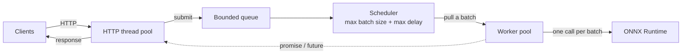

<p align="center">
  
</p>

<h1 align="center">finton</h1>

<p align="center">
  <b>A dynamic-batching inference server in C++20, for ordinary CPUs.</b><br>
  Inspired by NVIDIA Triton Inference Server. No GPU required.
</p>

<p align="center">
  
  
  
  <a href="https://x.com/helyoussfii"></a>
</p>

---

finton receives inference requests over HTTP, groups them into batches, and runs each batch on a pool of worker threads.

The name is *fin* + *ton*: in Moroccan Darija, *fin* means "where" and *ton* is tuna, the kind sold in a can. Hence the monkey asking where his tuna went.

It exists to study one question: **how do batch size and waiting time trade latency against throughput?** Both are exposed as plain numbers, so every setting between "answer at once" and "fill the batch" can be tried and measured.

> **Status.** finton serves a real model end to end: HTTP in, batching, one ONNX Runtime call per batch, HTTP out. It ships with an MNIST digit classifier as the example model. Measurements and multi-model support are next.

## How it works



1. An HTTP thread reads and parses a request, then submits it to the scheduler.
2. The request waits in a bounded queue. If the queue is full, the client gets a `503` at once.
3. A free worker asks the scheduler for a batch. The scheduler fills it until it reaches the maximum batch size, or until the oldest request has waited the maximum delay.
4. The worker runs the whole batch in one call to the backend.
5. Each request's promise is fulfilled, which wakes its HTTP thread, and the response goes back to the client.

The reasons behind each decision are in [design/arch.md](design/arch.md).

## Features

**Scheduling core**

- Dynamic batching driven by two settings: maximum batch size and maximum delay
- Thread-safe bounded queue that refuses work when full instead of growing
- Workers pull batches when they are free, so batch size adapts to the load
- One promise and future per request, with no shared result table

**HTTP server**

- Hand-rolled HTTP/1.1 parser, with no HTTP library
- Fixed thread pool, one connection per thread
- Keep-alive and pipelined requests
- Separate size limits for headers and body, checked before the body is read
- Timeouts for silent clients
- Graceful shutdown on `Ctrl-C`: every request already received is answered

**Not built yet**

- A model repository and several models at once
- Models with more than one input or output

## Quick start

You need Linux, CMake 3.22 or newer, and a C++20 compiler (GCC 13 recommended). The first configure downloads ONNX Runtime (about 8 MB) and a JSON library; nothing has to be installed by hand.

```bash
cmake -S . -B build-release -DCMAKE_CXX_COMPILER=g++-13 -DCMAKE_BUILD_TYPE=Release -DFINTON_TSAN=OFF
cmake --build build-release
./build-release/finton                                   # MNIST example model, port 3001
./build-release/finton --port 8080 --model my_model.onnx # your own model
./build-release/finton --help                            # every option
```

From another terminal:

```console
$ curl http://localhost:3001/health
{"status":"ok"}

$ head -c 3136 /dev/zero | curl -s http://localhost:3001/infer --data-binary @- | od -A n -t f4
    -0.044856027     0.007791661      0.06810082      0.02999374
     -0.12640963      0.14021875    -0.055284902    -0.049383815
      0.08432205    -0.054540414
```

The example model recognises handwritten digits. The request body is one 28 × 28 grayscale image as 784 raw 32-bit floats (3,136 bytes, here an all-black image). The response is 10 raw floats, one score per digit from 0 to 9; the highest score is the model's answer.

Requests that arrive together are run as one batch, with a single call to the model:

```bash
for i in $(seq 32); do head -c 3136 /dev/zero | curl -s -o /dev/null http://localhost:3001/infer --data-binary @- & done; wait
```

## HTTP API

| Method | Path | Description |
|---|---|---|
| `GET` | `/health` | Returns `200` when the server is up |
| `POST` | `/infer` | Runs one input through the model. Body: the input as raw little-endian 32-bit floats. Response: the output in the same format (`application/octet-stream`) |

| Status | Meaning |
|---|---|
| `200` | Success |
| `400` | The request is not valid HTTP, or the body of `/infer` is not the number of floats the model expects |
| `404` | Unknown method or path |
| `413` | `Content-Length` is over the body limit |
| `431` | The headers are over the header limit |
| `500` | Unexpected error while handling the request |
| `503` | The server is overloaded: the queue is full, or every HTTP thread is busy |

## Configuration

Settings are command-line options:

| Option | Default | Meaning |
|---|---|---|
| `--port` | 3001 | Port to listen on |
| `--model` | `models/mnist/model.onnx` | The `.onnx` model to serve |
| `--batch` | 8 | Most requests in one batch |
| `--delay-ms` | 5 | Longest time a request is held back to fill a batch |
| `--workers` | 2 | Threads that run batches |
| `--threads` | 0 | Threads ONNX Runtime uses inside one inference. 0 keeps its default, one per core |
| `--queue` | 64 | Requests that can wait in the scheduler. Beyond this: `503` |
| `--http-threads` | 64 | HTTP threads, which is also the most requests in flight |

The size limits (8 KB for headers, 10 MB for a body), the 5 second timeout for silent clients and the waiting line for connections are set in [`src/header/server.hpp`](src/header/server.hpp).

finton reads the input name, shape and size from the model itself and prints what it found at startup. It supports models with one float input and one float output, where only the batch dimension is flexible.

`--batch 1` with `--delay-ms 0` favours latency. A large batch with a long delay favours throughput.

Keep `--http-threads` above `--batch` × `--workers`. Each HTTP thread sleeps while its request is in the scheduler, so with fewer threads the batches can never fill.

## Measuring

`loadgen` sends requests from many connections at once and reports throughput and latency percentiles. Each client sends a request, waits for the response, then sends the next one.

```console
$ ./build-release/loadgen --clients 16 --seconds 3
clients 16 | 3.00 s measured
completed  : 23637  (rejected with 503 : 0, failed : 0)
throughput : 7879.00 requests/s
latency ms : mean 2.03 | p50 1.92 | p95 2.93 | p99 3.74 | max 7.88
```

`tools/sweep.sh` restarts finton once per value of one setting and prints a table. It can sweep `batch`, `delay-ms`, `workers`, `threads` or `clients`:

```bash
tools/sweep.sh batch "1 2 4 8 16 32"
CLIENTS=64 WORKERS=4 tools/sweep.sh delay-ms "0 1 5 20"
```

There are two example models. MNIST is included and is tiny (784 floats in, well under a millisecond per call), so the cost of HTTP and threads dominates. MobileNetV2 is downloaded separately (14 MB) and is a 224 × 224 colour image classifier (150,528 floats in, tens of milliseconds per call), so the model dominates:

```bash
mkdir -p models/mobilenet
curl -L -o models/mobilenet/model.onnx https://github.com/onnx/models/raw/main/validated/vision/classification/mobilenet/model/mobilenetv2-12.onnx
MODEL=models/mobilenet/model.onnx CLIENTS=16 tools/sweep.sh batch "1 2 4 8"
```

When finton stops it prints how many batches it ran and their average size, which shows whether the batches really filled.

Always measure with the release build. Keep `--workers` × `--threads` at or below the number of cores, and remember that the load generator uses cores too when it runs on the same machine.

## Build configurations

| Configuration | Command | Use it for |
|---|---|---|
| Sanitized (default) | `cmake -S . -B build -DCMAKE_CXX_COMPILER=g++-13` | Correctness. ThreadSanitizer reports data races |
| Release | `cmake -S . -B build-release -DCMAKE_CXX_COMPILER=g++-13 -DCMAKE_BUILD_TYPE=Release -DFINTON_TSAN=OFF` | Timing |

Follow either with `cmake --build <directory>`.

Timings from the sanitized build mean nothing: the sanitizer makes the program 5 to 15 times slower.

**ThreadSanitizer and GCC 11.** With GCC 11 the sanitized build can stop at startup with `unexpected memory mapping`, and it reports data races on the queue that are not real. Its runtime does not follow the mutex through a timed wait on a condition variable. GCC 13 has neither problem.

**ThreadSanitizer and ONNX Runtime.** ONNX Runtime is a prebuilt library that the sanitizer cannot see inside, so its internal locking shows up as false reports. Run the sanitized build with `TSAN_OPTIONS=suppressions=tsan.supp ./build/finton` to hide the data-race ones. A few `unlock of an unlocked mutex` reports from ONNX Runtime's own threads remain; they point at a mutex allocated while the model is loaded, not at finton's code.

## Tests

```bash
cmake --build build
ctest --test-dir build --output-on-failure
```

The tests cover the HTTP parser: valid requests, incomplete requests, malformed requests and the size limits.

## Layout

```
src/
  main.cpp           wires the scheduler, the workers and the server
  header/            class declarations
    request.hpp        a request, its response, and the promise that links them
    queue.hpp          thread-safe bounded queue
    scheduler.hpp      batching policy
    workers.hpp        worker thread pool
    backend.hpp        what a backend is : a batch in, one output per request out
    onnxbackend.hpp    the backend that runs a model with ONNX Runtime
    http_parser.hpp    HTTP/1.1 request parser
    server.hpp         HTTP server and its settings
  lib/               implementations
tests/               parser tests
tools/               load generator and sweep script
models/              example model (MNIST digit classifier)
design/              design document, diagrams and logo
```

## Roadmap

- [x] Queue, scheduler and worker pool
- [x] HTTP front end
- [x] Request payloads as raw bytes (`application/octet-stream`)
- [x] Real backend with ONNX Runtime
- [x] Real batching: one tensor and one model call per batch
- [ ] Measurements on a real model
- [ ] Several models, each with its own scheduler

## About

finton is a learning project by Hamza Elyoussfi, built to understand how inference serving works under the hood.

The scheduling core (queue, scheduler, workers) is written by hand. The HTTP layer, the build files, the tests and the documentation were written with AI assistance.

Follow the progress on X: [@helyoussfii](https://x.com/helyoussfii)
