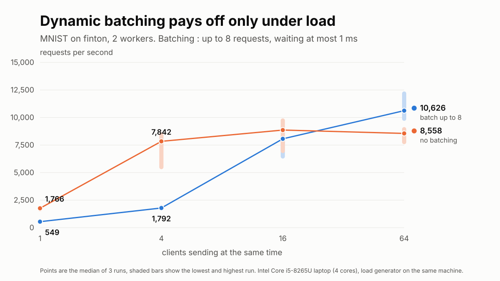
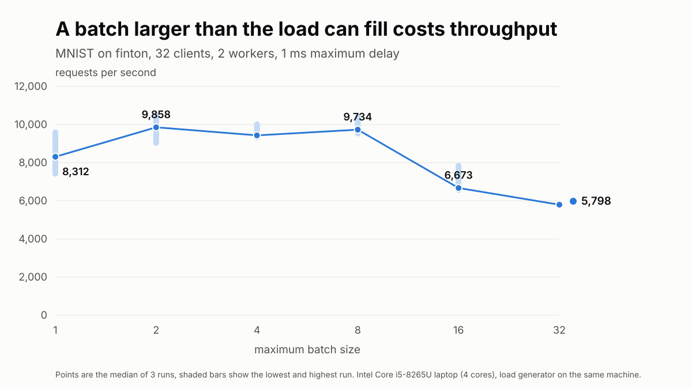
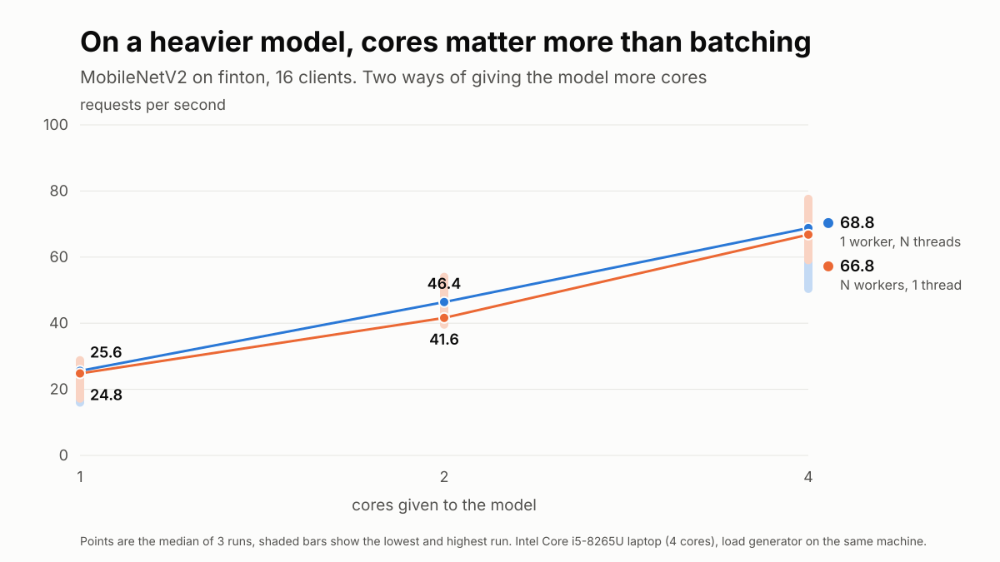
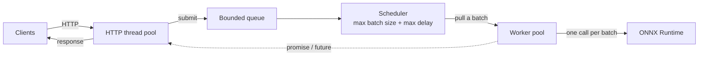

<p align="center">
  
</p>

<h1 align="center">finton</h1>

<p align="center">
  <b>A dynamic-batching inference server for ordinary CPUs, written in C++20.</b><br>
  Inspired by NVIDIA Triton Inference Server. No GPU required.
</p>

<p align="center">
  
  
  
  
  <a href="https://x.com/helyoussfii"></a>
</p>

---

finton serves an ONNX model over HTTP. It groups the requests that arrive together into one batch, runs the batch in a single call to the model, and sends each client its own answer.

```bash
./finton --model my_model.onnx
```

I built it to answer one question with measurements instead of folklore: **what does dynamic batching really buy you on a CPU?** The two settings that control it, the maximum batch size and the maximum delay, are plain numbers on the command line, so every point between "answer at once" and "fill the batch" can be tried.

The name is *fin* + *ton*. In Moroccan Darija, *fin* means "where" and *ton* is tuna, the kind sold in a can. Hence the monkey asking where his tuna went.

## What the measurements say

Three findings, from a 4-core laptop. Every number is the median of three runs; the full tables are in [benchmarks/RESULTS.md](benchmarks/RESULTS.md).

### 1. Batching pays off only under load

<p align="center"></p>

On a small model (MNIST), with batches of up to 8 and a 1 ms delay:

| Clients | No batching | Batching | Difference |
|---|---|---|---|
| 1 | 1,766 requests/s | 549 requests/s | 3.2 times slower |
| 4 | 7,842 requests/s | 1,792 requests/s | 4.4 times slower |
| 16 | 8,865 requests/s | 8,066 requests/s | about the same |
| 64 | 8,558 requests/s | 10,626 requests/s | 24% faster |

With few clients a batch can never fill, so every request waits the full delay for company that never comes. With many clients the batches fill at once and one call to the model does the work of eight. The delay is the price; the load decides whether you get anything for it.

### 2. A batch larger than the load can fill costs throughput

<p align="center"></p>

With 32 clients and 2 workers, batch sizes from 2 to 8 all land between 9,400 and 9,900 requests/s. At 16 the throughput drops to 6,700, and at 32 to 5,800. A large batch lets one worker take most of the waiting requests while the other has little to do. The maximum batch size has to be chosen against the load, not set as high as possible.

The maximum delay had no measurable effect in this test: between 0 and 5 ms the throughput stayed around 11,000 requests/s, because under this load the batches fill before the delay matters.

### 3. On a heavier model, cores matter more than batching

<p align="center"></p>

MobileNetV2 takes a 224 × 224 colour image and needs tens of milliseconds per call. Here:

- Going from 1 to 4 cores multiplied the throughput by about 2.7, from 25 to 68 requests/s.
- It made no difference whether the cores were used as 4 workers with 1 thread each, or 1 worker with 4 threads inside the model.
- Batching showed no clear gain. The differences between batch sizes of 1, 2, 4 and 8 were smaller than the spread between two runs of the same setting.

A plausible reading: on a CPU the cost of this model grows in step with the batch, so there is little fixed cost for a batch to share. On the small model the fixed cost per request is a large part of the total, which is why batching helps there.

### How to read these numbers

- The load generator ran on the same laptop as the server and competes for the same 4 cores.
- A laptop CPU changes speed with temperature. Each chart shows the lowest and highest run as a shaded bar, and some are wide.
- Two models on one machine is not a general law. The scripts are in the repository so the experiment can be repeated elsewhere: see [Measuring](#measuring).

## How it works



1. An HTTP thread reads and parses a request, then submits it to the scheduler.
2. The request waits in a bounded queue. If the queue is full, the client gets a `503` at once.
3. A free worker asks the scheduler for a batch. The scheduler fills it until it reaches the maximum batch size, or until the oldest request has waited the maximum delay.
4. The worker joins the inputs into one tensor and runs the whole batch in a single call to the model.
5. The output is split per request. Each request's promise is fulfilled, which wakes its HTTP thread, and the response goes back to the client.

The reasons behind each decision are in [design/arch.md](design/arch.md).

## Features

**Scheduling core**

- Dynamic batching driven by two settings: maximum batch size and maximum delay
- Thread-safe bounded queue that refuses work when full instead of growing
- Workers pull batches when they are free, so the batch size adapts to the load
- One promise and future per request, with no shared result table

**Model backend**

- Runs any ONNX model with one float input and one float output
- Reads the input name, shape and size from the model: no configuration file
- One model call per batch; models with a fixed batch size of 1 still work, one call per request
- Refuses an unsupported model at startup with a clear message

**HTTP server**

- Hand-rolled HTTP/1.1 parser, with no HTTP library
- Fixed thread pool, one connection per thread
- Keep-alive and pipelined requests
- Separate size limits for headers and body, checked before the body is read
- Timeouts for silent clients
- Graceful shutdown on `Ctrl-C`: every request already received is answered

## Quick start

### With Docker

```bash
git clone https://github.com/ELyoussfiHamza/finton.git
cd finton
docker build -t finton .
docker run --rm -p 3001:3001 finton
```

### From source

You need Linux, CMake 3.22 or newer, and a C++20 compiler (GCC 13 recommended). The first configure downloads ONNX Runtime (about 8 MB) and a JSON library; nothing has to be installed by hand.

```bash
git clone https://github.com/ELyoussfiHamza/finton.git
cd finton
cmake -S . -B build-release -DCMAKE_CXX_COMPILER=g++-13 -DCMAKE_BUILD_TYPE=Release -DFINTON_TSAN=OFF
cmake --build build-release
./build-release/finton
```

### Try it

Either way, finton starts on port 3001 with the example model, an MNIST digit classifier, and prints what it understood:

```
Model models/mnist/model.onnx | input Input3 : float32 [N, 1, 28, 28], 784 floats per request | output Plus214_Output_0 | batching yes | threads per inference default
Settings | batch 8 | delay 5 ms | workers 2 | queue 64 | http threads 64
finton is listening on port 3001
```

From another terminal, the demo script draws three digits, sends them, and prints the model's answers. It needs only Python 3:

```console
$ python3 tools/demo.py
              ######
              ######
              ######
              ...
    drew a 1, the model says 1   (scores : -5.6 13.5 -5.0 -3.4 2.6 -4.5 -4.7 0.8 -2.4 -4.0)

3 of 3 recognised
```

Or by hand with `curl`:

```console
$ curl http://localhost:3001/health
{"status":"ok"}

$ head -c 3136 /dev/zero | curl -s http://localhost:3001/infer --data-binary @- | od -A n -t f4
    -0.044856027     0.007791661      0.06810082      0.02999374
     -0.12640963      0.14021875    -0.055284902    -0.049383815
      0.08432205    -0.054540414
```

The request body is one 28 × 28 grayscale image as 784 raw 32-bit floats (3,136 bytes, here an all-black image). The response is 10 raw floats, one score per digit from 0 to 9; the highest score is the model's answer.

### Your own model

```bash
./build-release/finton --model path/to/model.onnx --port 8080

# or with Docker
docker run --rm -p 3001:3001 -v "$PWD/model.onnx:/model.onnx:ro" finton --model /model.onnx
```

finton supports models with one float input and one float output, where only the first dimension (the batch) is flexible. That covers most image classifiers. The startup line tells you how many floats a request must contain.

## HTTP API

| Method | Path | Description |
|---|---|---|
| `GET` | `/health` | Returns `200` when the server is up |
| `POST` | `/infer` | Runs one input through the model. Body: the input as raw little-endian 32-bit floats. Response: the output in the same format (`application/octet-stream`) |

| Status | Meaning |
|---|---|
| `200` | Success |
| `400` | The request is not valid HTTP, or the body is not the number of floats the model expects |
| `404` | Unknown method or path |
| `413` | `Content-Length` is over the body limit |
| `431` | The headers are over the header limit |
| `500` | The model failed on this batch, or another unexpected error |
| `503` | The server is overloaded: the queue is full, or every HTTP thread is busy |

## Options

| Option | Default | Meaning |
|---|---|---|
| `--port` | 3001 | Port to listen on |
| `--model` | `models/mnist/model.onnx` | The `.onnx` model to serve |
| `--batch` | 8 | Most requests in one batch |
| `--delay-ms` | 5 | Longest time a request is held back to fill a batch |
| `--workers` | 2 | Threads that run batches |
| `--threads` | 0 | Threads ONNX Runtime uses inside one inference. 0 keeps its default, one per core |
| `--queue` | 64 | Requests that can wait in the scheduler. Beyond this: `503` |
| `--http-threads` | 64 | HTTP threads, which is also the most requests in flight |

Three rules of thumb, the first two straight from the measurements above:

- Under light load, use `--delay-ms 0`. A delay only pays when enough requests arrive to fill the batch.
- Keep `--batch` at or below the number of requests that are usually waiting.
- Keep `--http-threads` above `--batch` × `--workers`, and `--workers` × `--threads` at or below the number of cores.

The size limits (8 KB for headers, 10 MB for a body), the 5 second timeout for silent clients and the waiting line for connections are set in [`src/header/server.hpp`](src/header/server.hpp).

## Measuring

`loadgen` sends requests from many connections at once and reports throughput and latency percentiles. Each client sends a request, waits for the response, then sends the next one.

```console
$ ./build-release/loadgen --clients 16 --seconds 3
clients 16 | 3.00 s measured
completed  : 23637  (rejected with 503 : 0, failed : 0)
throughput : 7879.00 requests/s
latency ms : mean 2.03 | p50 1.92 | p95 2.93 | p99 3.74 | max 7.88
```

`tools/sweep.sh` restarts finton once per value of one setting and prints a table. It can sweep `batch`, `delay-ms`, `workers`, `threads` or `clients`:

```bash
tools/sweep.sh batch "1 2 4 8 16 32"
CLIENTS=64 WORKERS=4 tools/sweep.sh delay-ms "0 1 5 20"
```

When finton stops it prints how many batches it ran and their average size, which shows whether the batches really filled.

### Reproducing the results above

MobileNetV2 is not stored in the repository (14 MB). Download it once, then run everything:

```bash
mkdir -p models/mobilenet
curl -L -o models/mobilenet/model.onnx https://github.com/onnx/models/raw/main/validated/vision/classification/mobilenet/model/mobilenetv2-12.onnx

benchmarks/run_all.sh              # every sweep, three times : about 20 minutes
python3 benchmarks/make_charts.py  # tables and charts, standard library only
```

Always measure with the release build, on a machine that is doing nothing else.

## Build configurations

| Configuration | Command | Use it for |
|---|---|---|
| Release | `cmake -S . -B build-release -DCMAKE_CXX_COMPILER=g++-13 -DCMAKE_BUILD_TYPE=Release -DFINTON_TSAN=OFF` | Running and measuring |
| Sanitized (default) | `cmake -S . -B build -DCMAKE_CXX_COMPILER=g++-13` | Correctness. ThreadSanitizer reports data races |

Follow either with `cmake --build <directory>`.

Timings from the sanitized build mean nothing: the sanitizer makes the program 5 to 15 times slower.

**ThreadSanitizer and GCC 11.** With GCC 11 the sanitized build can stop at startup with `unexpected memory mapping`, and it reports data races on the queue that are not real. Its runtime does not follow the mutex through a timed wait on a condition variable. GCC 13 has neither problem.

**ThreadSanitizer and ONNX Runtime.** ONNX Runtime is a prebuilt library that the sanitizer cannot see inside, so its internal locking shows up as false reports. Run the sanitized build with `TSAN_OPTIONS=suppressions=tsan.supp ./build/finton` to hide the data-race ones. A few `unlock of an unlocked mutex` reports from ONNX Runtime's own threads remain; they point at a mutex allocated while the model is loaded, not at finton's code.

## Tests

```bash
cmake --build build
ctest --test-dir build --output-on-failure
```

The tests cover the HTTP parser: valid requests, incomplete requests, malformed requests and the size limits.

## Layout

```
src/
  main.cpp           options, and the wiring of backend, scheduler, workers and server
  header/            class declarations
    request.hpp        a request, its response, and the promise that links them
    queue.hpp          thread-safe bounded queue
    scheduler.hpp      batching policy
    workers.hpp        worker thread pool
    backend.hpp        what a backend is : a batch in, one output per request out
    onnxbackend.hpp    the backend that runs a model with ONNX Runtime
    http_parser.hpp    HTTP/1.1 request parser
    server.hpp         HTTP server and its settings
  lib/               implementations
  experiments/       a standalone ONNX Runtime example, outside the server
tests/               parser tests
tools/               demo script, load generator and sweep script
benchmarks/          benchmark script, raw results, charts
models/              example model (MNIST digit classifier)
design/              design document, diagrams and logo
Dockerfile           builds a small image with finton, ONNX Runtime and the example model
```

## Limits

- One model per server.
- One input and one output per model, both 32-bit floats. Text models, which take several integer inputs of varying length, are refused at startup.
- An HTTP thread is held by its connection, even when the client is idle between two requests.
- Linux only.

## Roadmap

- [x] Queue, scheduler and worker pool
- [x] HTTP front end
- [x] Request payloads as raw bytes
- [x] Real backend with ONNX Runtime, one model call per batch
- [x] Measurements on real models
- [ ] Models with several inputs and outputs, and a request format that describes them
- [ ] Several models at once, each with its own scheduler
- [ ] A model metadata endpoint
- [x] A Docker image
- [ ] Prebuilt releases
- [ ] An event loop (`epoll`) in place of one thread per connection

## About

finton is a learning project by Hamza Elyoussfi, built to understand how inference serving works under the hood.

**What was written by hand.** The scheduling core (queue, scheduler, workers), the batching logic of the ONNX backend, and the first version of the HTTP server: the socket setup, the accept loop, reading a request that arrives in pieces, and the size limits.

**What was written with AI assistance (Claude).** The HTTP thread pool, keep-alive and graceful shutdown; the model-agnostic part of the backend; the load generator and benchmark scripts; the build files, the tests and the documentation. The design decisions were taken together and are explained in the design document.

Follow the progress on X: [@helyoussfii](https://x.com/helyoussfii)

## License

[MIT](LICENSE)
